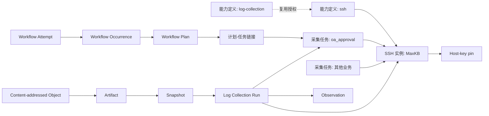

# AgentOps 日志采集与 Workflow 管理迁移至 DSH 的设计与实施规格（v9）

| 项目 | 内容 |
|---|---|
| 日期 | 2026-11-13 |
| 状态 | R9 CANDIDATE — 已按 R4-R8 红队审查修订，待最终冻结审查 |
| 原系统 | `<legacy-repo>` |
| 目标系统 | `<dsh-repo>` |
| 上位文档 | `agentops/PLAN-capability-center-dsh.md` |
| 控制库 DDL | `agentops/sql/log-collection-control.schema.v9.sql` |
| DDL SHA-256 | `9AC2B1E757995796BAE09B3803DEBFB9B57A91D2FEC686F27D3E27CC1F122349` |
| DDL 验证器 | `agentops/sql/verify-log-collection-control-schema.v9.mjs` |
| 验证器 SHA-256 | `7E4369379F5EA42FBE74D385F72CDAE5A9BF97E0187C4C969E3D10EB74B56E9B` |
| 可执行验证结果 | `47/47 PASS`，19 个业务表、91 trigger、`PRAGMA foreign_keys=ON`、完整性检查 `ok` |
| 历史审查 | `agentops/reviews/REVIEW-log-collection-dsh-2026-11-13.md`；R4 原始报告见 `REVIEW-log-collection-dsh-2026-11-13-r4.md` |

> 本文是设计与实施规格，不代表功能已经落地。当前门禁仍是：不得冻结生产 schema、不得迁移生产任务、不得接 MaxKB 生产采集、不得宣称日志采集已迁移完成。

## 1. 结论

本次应把“日志采集”和“Workflow 管理”纳入同一迁移计划，但不要塞进同一个可发布 PR。

结论如下：

1. 日志采集不创建新的连接器实例。采集任务引用 SSH 服务器实例，一个 SSH 实例可被多个采集任务复用。
2. 日志采集任务、任务 ACL、Workflow 计划、计划到任务的引用、运行、快照、对象、观察、租约、审计和迁移状态统一放入一个 `agentops-control.db`。
3. 能力中心仍是 SSH 实例、凭证、preset 绑定和 host-key pin 的唯一事实源；日志控制库只保存运行期冻结的实例 ID、实例摘要和凭证 generation。
4. Workflow Manager 是唯一的计划写入口和唯一 cron 触发入口。日志采集包不得实现第二套定时器。
5. 原 AgentOps 的 `schedules.yaml` 自由文本 `inputs` 迁移为“计划 + 显式任务链接”。计划触发时，Workflow Manager 从链接表解析 canonical `log_task_id`，不接受模型或浏览器临时覆盖。
6. 本地目录不由用户输入。任务只保存 `storage_key = tenant_key/task_id_normalized`；运行期解析为 `$DSH_HOME/agentops/log-collections/<storage_key>/`。部署可用配置覆盖根，但不能覆盖到逃逸路径。
7. 全文件采集采用内容寻址发布。快照先在独立 staging 中完成哈希、文件 `fsync`、父目录 `fsync` 和原子 rename，再提交数据库引用。数据库失败只允许留下孤儿对象，不允许发布悬空快照。
8. SSH host-key 必须在读取凭证前验真。MaxKB 的权威 key 位于 `/usr/local/openssh/etc/`，不是常规 `/etc/ssh/`。这是一个必须写入负向测试的现场事实。
9. 旧凭证迁移不是“已经完成”的可用闭环。现场 `credentials.db` 只有 `credentials` 表，现有 `ConnectionStore` 导入器会创建空 `connections` 表并导入 0 条。专用迁移器必须先分类 15 条旧凭证，再逐条重封。
10. 旧日志历史必须明确选择只读归档、摘要迁移或全量迁移。任何方案都必须冻结切点、源哈希和统计 SQL，不能使用漂移计数冒充验收基线。

## 2. 已验证现状

### 2.1 原 AgentOps 三层模型

```text
integration_instances(capability_id=ssh)
  ↑ ssh_instance_id
log_collection_tasks
  ↑ log_task_id
schedules
```

一手证据：

- `<legacy-repo>\orchestrator\log_collection_admin.py:1-40`：三层对象说明。
- `<legacy-repo>\orchestrator\log_collection_admin.py:236-270`：任务字段。
- `<legacy-repo>\orchestrator\log_collection_admin.py:178-233`：远端路径、实例和凭证校验。
- `<legacy-repo>\orchestrator\log_collection_admin.py:355-376`：删除任务前检查计划引用。
- `<legacy-repo>\tools\pull_logs.py:105-200`：工具只接受任务 ID，不接受 host/path 覆盖。
- `<legacy-repo>\web\src\components\LogCollectionSettings.tsx:238-533`：日志采集列表、表单、SSH 实例提示、删除冲突和“已停用”语义。
- `<legacy-repo>\web\src\pages\SchedulesPage.tsx:1-512`：计划 CRUD、cron 校验、下次触发、自由 JSON inputs 和删除确认。
- `<legacy-repo>\config\schedules.yaml`：旧计划 `oa-approval-collect` 和 `schedule-5` 均使用 `inputs.log_task_id=oa_approval`。

旧系统正确语义必须保留：

- SSH 凭证只在能力中心维护。
- 一个 SSH 实例服务多个采集任务。
- 一个任务可关联多个计划。
- 删除被计划引用的任务返回冲突，不静默级联删除计划。
- `pull_logs` 和 `log_query` 只接受任务 ID。
- 任务禁用、删除、计划停用均应在 UI 上明确显示。

旧系统必须修正或有明确替代的点：

- `local_path` 允许任意项目相对路径，目录边界不统一。
- `size+mtime` 位点不足以发现同尺寸重写和精度不足。
- 直接下载到目标文件，非原子发布。
- JSON 位点无事务、无 run/receipt。
- Agent 工具承担下载和状态文件写入，业务终态不清。
- 计划引用只靠 YAML 扫描，存在跨文件 TOCTOU。
- SFTP 登录使用 `AutoAddPolicy` 一类宽松 host-key 语义。

### 2.2 DSH 当前实现缺口

已验证的 DSH 现状：

- `packages/agentops/capability/src/catalog.ts:175-183`：`log-collection` 声明为复用 SSH，不创建日志实例。
- `packages/agentops/capability/src/catalog.ts:215-226`：`log_query`、`log_collection_cli` 仍 `runtimeAvailable=false`。
- `agentops/mappings/tool-map.yaml:232-237`：`log_query` 仍 `mapped: null`。
- `agentops/mappings/tool-map.yaml:319-324`：`pull_logs` 仍 `mapped: null`。
- `packages/agentops/client/src/client/schedules-panel.tsx:2-6`：计划页明确只读。
- `agentops/workflows/log-puller.yaml:21-25`：workflow 只接受旧 `pull_source_id`。
- `agentops/workflows/log-patrol.yaml:27-45`：workflow 接受旧 `log_source_id/log_dir`，不接受 canonical `log_task_id`。

当前 DSH 没有：

- 日志采集任务 schema、store、RPC、工具 handler、采集器、UI；
- Workflow 计划写路径、occurrence/attempt、可靠触发记录；
- 旧 AgentOps 日志任务和历史运行迁移；
- `log_query` 与 `pull_logs` 的可运行映射；
- 任务级 ACL。

### 2.3 能力中心与 MaxKB 故障判断

“能力中心已迁移”只能说明有关记录进入了 DSH 能力中心，不能说明闭环可用。当前至少有两个真实缺陷：

1. `packages/agentops/capability/src/probe.ts:151-205` 的 SSH 测试连接实现固定使用 Windows `.cmd` askpass，并把密码正文直接写入批处理文件。密码含 `&` 时，`cmd` 会把 `&` 当命令分隔符，导致实际传给 SSH 的密码被截断。现场同一 secret 用 Paramiko 可登录，说明不是 MaxKB 密码本身错误。
2. `probe.ts:176-180` 使用 `StrictHostKeyChecking=no` 和 `UserKnownHostsFile=NUL`，与生产安全的 host-key 要求相反。
3. 旧凭证导入器按 `ConnectionStore.list()` 读取源库，而现场源库只有 `credentials` 表。导入器会创建空 `connections` 表、导入 0 条并写成功标记，这不是真实迁移。

因此本次必须把“能力中心连接测试与旧凭证专用迁移”列为日志采集前置，不得用当前测试连接失败直接判定 MaxKB 凭证错误。

### 2.4 MaxKB 轮转与文件身份

现场确认：

- 目标系统：CentOS 7，内核 `3.10.0-1160.119.1.el7.x86_64`。
- 目标文件：`/opt/AI_Agent_Platform/logs/app/oa_audit.log`。
- 写入方：Docker 容器 `ai-agent-platform`。
- 轮转方式：Python `TimedRotatingFileHandler(when='midnight')` 的惰性 `rename+create`。
- 实际 rename 时刻不是固定 12:00，而是跨零点后的第一条日志触发。
- SFTP v3 的 `SSH_FXP_STAT` 不返回 inode；不能把 inode 作为 SFTP 必选完成条件。
- 文件系统为 xfs，空间充足；不影响本方案。

v9 的文件身份策略：

- 业务稳定身份是 canonical remote path：`/opt/AI_Agent_Platform/logs/app/oa_audit.log`。
- 每次运行读取完整 active 文件，计算 `full_sha256`；对上一完成观察的 `prior_size` 字节计算 `prefix_sha256`。
- 只有满足以下条件才可标记 `continuity_state='proved'`：
  - 当前文件 `byte_size >= prior_size`；
  - 当前文件前 `prior_size` 字节的哈希等于上一完成的 `full_sha256`；
  - 上一观察来自 completed run，且已有 published snapshot；
  - 当前 run 与上一观察不是同一 run。
- inode、device、file ID、mtime 是可选取证字段，写入 `identity_json`，但不作为 SFTP v3 的唯一完成条件。
- 如果远端未来提供只读 stat helper，可把 `identity_kind` 升级为 `inode_mtime_ns` 或 `file_id_mtime_ns`，不改变快照协议。
- 如果 prefix 不匹配或文件缩短，标为 `gap`/`unprovable`，不得静默当作正常增量。

active-only 的业务边界必须写明：

- 上级要求“永远拿 `oa_audit.log`”，因此不读取归档文件。
- `rename+create` 发生在两次运行之间时，活跃文件尾部可能进入归档而未被本任务读取。
- v9 将这种边界记录为 `ACTIVE_ONLY_ROTATION_BOUNDARY`，并在查询结果中返回 gap。快照可以完整保存当次 active 文件内容，但不能宣称跨轮转区间零丢失。
- 旧系统 3 次/天已经接受更长窗口；新系统默认建议每小时或 3 次/天中的至少一种。若业务要求零窗口，必须改为“active + 最近一个归档”策略，这不在当前 owner 已确认的 active-only 范围内。

## 3. 目标架构

### 3.1 对象关系



硬规则：

- `log-collection` 不创建实例。
- 采集任务不是连接器实例。
- 一个任务引用一个 SSH 实例。
- 一个 SSH 实例可服务多个任务。
- 一个任务可被多个计划引用。
- 工具只接受 canonical `log_task_id`。
- 任务、计划、运行、快照都按 tenant 隔离。

### 3.2 包和所有权

新增或扩展包：

```text
packages/agentops/control-store/
  SQLite 连接、迁移、BEGIN IMMEDIATE 事务、repository interfaces

packages/agentops/log-collection/
  task domain、ACL guard、SFTP collector、snapshot、retention、RPC、tools

packages/agentops/workflow-manager/
  schedule CRUD、cron claim、occurrence、attempt、workflow run 启动

packages/agentops/ui-log-collection/
  日志采集页面与运行详情

packages/agentops/client/
  Workflow 计划写页面、任务链接选择器、引用冲突
```

所有权矩阵：

| 数据 | 唯一所有者 | 日志采集包权限 |
|---|---|---|
| capability definition | `@agentops/dsh-capability` | 只读 |
| SSH instance | `@agentops/dsh-capability` | 只读引用 |
| credential/secret | `@agentops/dsh-capability` | 运行期申请 lease |
| host-key pin | `@agentops/dsh-capability` | 只读校验 |
| preset binding | `@agentops/dsh-capability` | 只读 |
| log task/ACL | control-store | task repository |
| workflow schedule/link | control-store | 只读查询引用 |
| occurrence/attempt | workflow-manager 经 control-store | 不写 |
| log run/snapshot/object | control-store | log collection 服务写 |
| migration marker | control-store | 迁移器写 |

`@deepseek-ai/dsh-ssh` 继续作为部署级单 alias 远端 helper，不承担多实例业务连接器。`@deepseek-ai/dsh-schedule` 继续用于 Session 提醒，不承担 Workflow 业务 cron。

### 3.3 唯一运行链

```text
Agent preset
  → pull_logs(log_task_id)
  → auth context(tenant, preset, domain)
  → log_collection_tasks[task_id]
  → task ACL
  → ssh instance binding
  → control-store run transaction
  → freeze ssh_instance_id, ssh_instance_digest, credential_generation
  → host-key preflight
  → credential lease
  → SFTP full-file read
  → staging hash/fsync/rename
  → snapshot transaction
```

任何一环不满足都失败关闭。禁止回退到环境变量、CWD、默认实例或其他 tenant 的任务。

## 4. 控制库设计

### 4.1 可执行 DDL 是契约

R4 的阻断项是“文字声称有约束，DDL 中没有；INSERT/UPDATE 仍可绕过”。v9 以原样执行 DDL 为准：

- `agentops/sql/log-collection-control.schema.v9.sql` 是当前 schema 候选。
- `agentops/sql/verify-log-collection-control-schema.v9.mjs` 原样执行 DDL 并运行 47 个正反例。
- 任何 schema 变更必须先更新 DDL 和验证器，再更新设计文字。
- 不允许在实现时“临时补 trigger”而不回写设计。

### 4.2 关键表

| 表 | 责任 |
|---|---|
| `control_store_meta` | schema version |
| `log_collection_tasks` | 任务定义、tenant、revision、soft delete、下一条 lease fence |
| `log_collection_task_acl` | preset 对任务的 pull/query 权限 |
| `workflow_schedules` | 计划定义、tenant、cron、模板输入、revision |
| `workflow_schedule_log_tasks` | 计划到任务的显式链接和 input key |
| `workflow_occurrences` | 每次计划触发、冻结输入、claim 状态 |
| `workflow_attempts` | occurrence 下的 workflow run 尝试 |
| `log_collection_runs` | 冻结任务输入、SSH 实例和凭证 generation |
| `log_collection_observations` | 每次运行的远端文件观察和连续性证明 |
| `log_collection_objects` | 内容寻址对象元数据 |
| `log_collection_snapshots` | 一次运行的不可变发布清单 |
| `log_collection_artifacts` | snapshot 内文件引用 |
| `log_collection_cursors` | 已完成运行的连续性 baseline |
| `log_collection_leases` | 单任务执行租约 |
| `log_collection_staging` | run/fence 独占 staging |
| `log_collection_audit` | 追加式审计 |
| `log_collection_migrations` | 迁移状态和回滚点 |

### 4.3 已由 DDL/验证器证明的约束

- 终态 run 不能重开。
- run 终态必须有或不得有 `finished_at`。
- run 状态转换闭集。
- 活跃状态必须有同 fence lease。
- lease 不能指向其他 task/run/fence。
- 终态 run 的 lease 自动清理且不能重建。
- snapshot 的 task/run/status 必须匹配。
- artifact 的 observation/run/task/path/hash/size 必须匹配。
- cursor 只能指向 completed run 的 observation。
- completed run 必须有匹配 snapshot 和 receipt。
- 任务 latest pointer 不能指向其他 task 的 run。
- task ID 非法字符、Windows 保留名、大小写碰撞拒绝。
- 软删除任务不允许 physical DELETE，且 task ID 不复用。
- 被计划引用的任务不能禁用或删除。
- schedule input template 不能覆盖链接注入的 `log_task_id`。
- occurrence 输入必须匹配链接任务的 canonical task ID。
- 同一计划同一 scheduled_for 不能重复创建 occurrence。
- migration failed 必须有 error 和 rollback point。
- ACL 无隐式记录；运行期 guard 必须空 ACL 拒绝。
- artifact retention 必须先过期 artifact，再过期 snapshot。
- 对象路径必须是 `<sha256前2位>/<sha256>`。

## 5. 本地目录与任务 ID

### 5.1 目录规则

部署配置：

```text
AGENTOPS_LOG_COLLECTION_ROOT
默认：$DSH_HOME/agentops/log-collections/
```

任务保存：

```text
storage_key = tenant_key || '/' || task_id_normalized
```

运行期路径：

```text
<resolved-root>/<tenant_key>/<task_id_normalized>/
```

staging 路径：

```text
<resolved-root>/.staging/<task_uid>/<run_id>/<lease_fence>/
```

对象目录：

```text
<resolved-root>/.objects/<sha256前2位>/<sha256>
```

规则：

- 任务不能输入绝对本地路径。
- 任务不能输入 `..`。
- 解析后必须仍在配置根内。
- 父目录符号链接必须验证，不能逃逸根。
- Windows 本地研发环境拒绝 `CON`、`PRN`、`NUL` 及带扩展名的同名保留项。
- tenant/task ID 大小写冲突拒绝。
- 任务 ID 删除后不复用，避免旧计划、历史路径和审计混淆。
- UI 显示逻辑路径和当前解析后的实际路径，但实际根只能由受信运维配置改。
- 提供复制按钮，但不允许任务表单改绝对路径。

### 5.2 为什么不是用户自由填 `local_path`

旧页面允许 `./logs/oa_approval` 一类路径。迁移后如果继续接受任意相对路径：

- 两个任务可争用同一目录；
- 跨租户身份可以碰撞；
- 逻辑快照与物理目录不再可对账；
- 恢复或换机后路径不可移植；
- 运行时容易因 CWD 或父目录符号链接逃逸。

因此“本地存储路径”字段保留在 UI 以保持操作认知，但变成只读派生字段。这属于明确的安全重构，不冒充原页面逐像素复刻。

## 6. SSH、host-key 与传输

### 6.1 Host-key 来源

MaxKB 的权威 ed25519 pin：

```text
SHA256:rRUjsuVBpbHwjlYknyX1dwnlpu161cM3GDkmZ1bXxio
```

来源：

- `/usr/local/openssh/etc/ssh_host_ed25519_key.pub`
- `ssh-keyscan` 结果
- SSH 握手 blob 本地重算

`/etc/ssh/ssh_host_ed25519_key.pub` 的 `SHA256:6szZAYC3…` 不生效，因为该 sshd 是自编译的 `/usr/local/openssh`，监听 2222。常规复制 `/etc/ssh` 会得到错误 pin，因此必须写负向测试。

### 6.2 Trust store

能力中心新增 `ssh_host_key_pins` 事实表，字段至少包括：

```text
instance_id
host
port
algorithm
public_key_fingerprint_sha256
status(active|next|retired)
valid_from
valid_until
revision
verified_by
verified_at
```

规则：

- host-key pin 必须先于 secret 获取完成校验。
- 同一 host:port 必须显式 pin，不接受 TOFU。
- 支持双 pin 轮换：新增 `next`，验证握手后把旧 pin 改为 `retired`，窗口结束后删除。
- 轮换必须审计，不能由临时环境变量覆盖。
- 禁止 `AutoAddPolicy`。
- 禁止 `StrictHostKeyChecking=no`。
- 禁止 `UserKnownHostsFile=NUL`。
- 如果使用 OpenSSH 客户端，必须 `StrictHostKeyChecking=yes`、受控 `UserKnownHostsFile`、`GlobalKnownHostsFile=/dev/null`、`UpdateHostKeys=no`。
- 推荐直接使用 Node SSH/SFTP 库的 host verifier，避免 Windows askpass 和命令行 quoting。

### 6.3 认证顺序

```text
1. TCP connect
2. SSH host-key handshake
3. 校验 pin
4. mismatch 立即 SSH_HOST_KEY_REJECTED，不读取 secret
5. 验证通过后申请 credential lease
6. 执行 password/key 认证
7. 认证成功后才开放 SFTP stat/list/read
```

当前 `CapabilityRuntime` 解析时会解密 secret。必须增加延迟 secret handle 或独立的 host-key preflight，使“host-key 先于 secret”成为可测试顺序，而不是口头约束。

### 6.4 凭证处理

- password 不写 argv、不写 `.cmd`、不写日志。
- key 认证读取实例配置中的私钥路径和可选 passphrase。
- Windows 本地开发不能依赖 `.cmd` askpass。
- credential lease 记录 instance ID、generation、请求者、run ID、过期时间。
- secret 只在内存中短暂存在，关闭连接后清空引用。
- 测试必须覆盖密码含 `&`、`%`、`!`、中文、空格和换行边界。
- 当前 MaxKB 密码含 `&` 的失败必须回归为通过。

## 7. 采集、连续性与发布

### 7.1 采集流程

```text
claim run lease
→ resolve capability instance snapshot
→ host-key preflight
→ credential lease
→ SFTP connect
→ stat canonical active file
→ full download to run/fence staging
→ fsync file
→ calculate full_sha256 and prefix_sha256
→ write manifest to staging
→ fsync manifest
→ atomic rename object files into .objects
→ fsync object parent directories
→ BEGIN IMMEDIATE control-store transaction
→ verify lease owner/fence and task revision
→ insert objects/observations/artifacts/snapshot
→ set published_snapshot_id
→ set run completed/partial
→ update task latest pointer
→ advance cursors only for completed run
→ write audit
→ COMMIT
→ cleanup staging
```

数据库事务失败时：

- 已 rename 的对象成为孤儿对象，不允许被 snapshot 引用；
- run 不标记 completed；
- maintenance 扫描孤儿对象并清理；
- 不能把“文件存在”当作发布成功。

### 7.2 为什么使用内容寻址

内容寻址解决：

- 同一内容跨 run 去重；
- 文件名不承担身份；
- 数据库指针只需要 64 位十六进制 SHA-256；
- 文件成功但 DB 失败时只留下可 GC 孤儿；
- DB 成功时对象必须在提交前已 fsync；
- snapshot 清单可独立验证。

对象不可变。artifact 过期只清除对象引用并标记 `retention_state=expired`，保留哈希、大小和审计元数据。

### 7.3 连续性

观察字段：

```text
identity_kind
identity_json
byte_size
prior_size
prefix_sha256
full_sha256
continuity_state(initial|proved|unprovable|gap)
gap_json
```

规则：

- `initial`：本代文件第一次观察。
- `proved`：上一完成观察的完整哈希等于当前文件前缀哈希。
- `unprovable`：缺少可靠 prior、metadata 不足或上一 run partial。
- `gap`：检测到截断、替换、越界或轮转窗口。
- partial run 不推进 cursor。
- 只有 completed run 才能成为下一轮 baseline。
- 同 inode/size/mtime 但内容变化必须通过 full hash 发现。
- prefix 重叠为零不得标记 proved。

## 8. Workflow 管理

### 8.1 原实现与新实现

原 AgentOps：

```text
config/schedules.yaml
  → workflow_id
  → inputs(JSON)
  → orchestrator.run(workflow_id, inputs)
```

新 DSH：

```text
workflow_schedules
  + workflow_schedule_log_tasks
  → workflow_occurrences(schedule revision + frozen inputs)
  → workflow_attempts(workflow run id)
  → workflow compiler run
```

本方案不把计划写逻辑放进日志采集包，也不让日志采集包拥有 cron。日志采集只提供“任务查询/引用查询/运行请求”。

### 8.2 Cron 与幂等

Workflow Manager 的单一 scheduler loop 负责：

1. 计算 due schedule；
2. `BEGIN IMMEDIATE`；
3. 按 `(schedule_id, scheduled_for)` 插入 occurrence，唯一约束防重复；
4. 从链接表解析任务 ID 并校验任务 live+enabled；
5. 冻结 `inputs_json` 和 `schedule_revision`；
6. 提交；
7. 领取 occurrence，创建 attempt；
8. 调用 workflow compiler；
9. 写 receipt/error；
10. 重试或进入 needs_attention。

崩溃恢复：

- occurrence pending 可重新 claim；
- claimed 超时进入 failed 或回到 pending 按显式策略；
- attempt 只能有一个 active；
- 终态 occurrence/attempt 不可修改；
- 任务在触发时已禁用/删除则 occurrence 失败关闭，不静默改用其他任务。

### 8.3 Workflow 输入契约

必须更新：

- `agentops/workflows/log-puller.yaml`：`pull_source_id` → `log_task_id`。
- `agentops/workflows/log-patrol.yaml`：`log_source_id/log_dir` → `log_task_id`。
- `agentops/agents/log_puller.yaml`：移除旧 source 参数。
- `agentops/agents/log_analyst.yaml`：移除自由 `log_dir`。
- `agentops/mappings/tool-map.yaml`：接线 `pull_logs` / `log_query`。
- 生成的 preset 与 tool catalogue。

旧键兼容只允许存在于迁移适配层：

```text
pull_source_id → log_task_id
log_source_id → log_task_id
```

两个旧键同时出现且不能证明指向同一任务时，迁移进入 pending。

## 9. API 与工具

### 9.1 RPC envelope

沿用 DSH bridge 真实 envelope：

```ts
type RpcResult<T> =
  | { ok: true; value: T }
  | { ok: false; error: { code: string; message: string; details: object } }
```

业务状态放在 `value.status`，不依赖物理 HTTP 201/202/409。

### 9.2 任务 API

```text
GET    /api/agentops/log-collection/tasks
GET    /api/agentops/log-collection/tasks/{taskId}
POST   /api/agentops/log-collection/tasks
PATCH  /api/agentops/log-collection/tasks/{taskId}
DELETE /api/agentops/log-collection/tasks/{taskId}
POST   /api/agentops/log-collection/tasks/{taskId}/runs
GET    /api/agentops/log-collection/runs/{runId}
POST   /api/agentops/log-collection/runs/{runId}/cancel
GET    /api/agentops/log-collection/tasks/{taskId}/acl
PUT    /api/agentops/log-collection/tasks/{taskId}/acl/{preset}
DELETE /api/agentops/log-collection/tasks/{taskId}/acl/{preset}
GET    /api/agentops/log-collection/tasks/{taskId}/references
```

创建输入：

```ts
interface CreateLogCollectionTask {
  taskId?: string
  name: string
  sshInstanceId: string
  remotePaths: string[]
  localMaxDays: number
  enabled: boolean
}
```

tenant、owner domain、created by、storage key、revision 和 ACL grantor 从认证上下文派生，不接受请求体覆盖。

列表响应至少包含：

```ts
interface LogCollectionTaskListItem {
  taskId: string
  name: string
  sshInstance: {
    instanceId: string
    name: string
    status: 'enabled' | 'disabled'
    credentialConfigured: boolean
    hostKeyConfigured: boolean
  }
  remotePaths: string[]
  localPathDisplay: string
  localMaxDays: number
  enabled: boolean
  scheduleCount: number
  schedules: Array<{ id: string; name: string; cron: string; enabled: boolean; nextRunAt: string | null }>
  nextRunAt: string | null
  latestRun: { runId: string; status: string; finishedAt: string | null } | null
  unavailableReason: string | null
  revision: number
}
```

### 9.3 工具

`pull_logs`：

```ts
{ log_task_id: string }
```

`log_query`：

```ts
{
  log_task_id: string
  time_range?: string
  level?: string
  max_matches?: number
}
```

规则：

- 禁止 host、port、username、password、credential、remote path、local root。
- `log_puller` 只挂 `pull_logs`。
- `log_analyst` 只挂 `log_query`。
- `manager` 不直接挂两个工具。
- guard 同时校验 preset、tenant、task ACL、SSH 实例绑定和能力授权。
- handler 不能绕过 guard。
- 空 ACL 或 revoked ACL 一律拒绝。
- 工具返回 structured error union，不允许 `snapshot_id` 在失败时为非空类型。

## 10. UI 复刻与明确差异

### 10.1 日志采集页

以 `LogCollectionSettings.tsx:238-533` 为基线复刻：

- 页面标题“日志采集”；
- 说明“采集任务引用 SSH 服务器实例；定时计划在「定时计划」页面独立维护。”；
- 刷新、新增采集任务；
- 两张说明卡；
- 错误条、加载态、空态；
- 表格列：任务、SSH 实例、远程路径、本地路径、保留天数、关联定时计划、状态、操作；
- 新建/编辑弹窗字段：任务名称、任务 ID、SSH 实例、远端路径 textarea、本地存储路径、保留天数、启用；
- SSH 下拉只列 SSH capability，不可用实例仍显示并标记“已停用 / 未配置凭证 / host-key 未配置”；
- 删除弹窗文案“删除后采集任务配置不可恢复，不会删除远程或本地日志文件。”；
- 有关联计划时显示计划列表、cron、已启用/已停用，并禁用删除按钮。

明确新增或改变：

- 本地路径只读派生，不允许任意输入。
- 任务 ACL 在详情或独立授权区域维护，只有 tenant/domain 管理角色可改。
- host-key 未配置时测试连接和采集均禁用。
- 预览实际解析路径与逻辑路径。
- 运行详情、snapshot、gap、receipt、retention 状态是新增能力。

### 10.2 计划页

复刻 `SchedulesPage.tsx` 的计划管理：

- 列表、搜索、仅看启用；
- 新建/编辑/删除；
- workflow_id 下拉；
- name、cron、cron 预设、next fire 预览；
- enabled；
- inputs JSON 文本域；
- ID 编辑时只读；
- 删除确认。

明确重构：

- 对日志 workflow，增加“关联采集任务”选择器，写入 `workflow_schedule_log_tasks`。
- inputs JSON 不允许覆盖受链接管理的 `log_task_id`。
- cron 校验、next fire 和 occurrence 记录由 Workflow Manager 统一负责。

## 11. 旧数据迁移

### 11.1 输入清单

```text
<legacy-repo>\audit.db
<user-home>\.agentops\credentials.db
<user-home>\.agentops\private\log-collection.yaml
<legacy-repo>\config\schedules.yaml
<legacy-repo>\config\patrol.yaml
<legacy-repo>\workflows\log-collector.yaml
<legacy-repo>\workflows\log-patrol.yaml
<legacy-repo>\config\agents\log_collector.yaml
<legacy-repo>\config\agents\log_analyst.yaml
<legacy-repo>\config\tools\pull_logs.yaml
<legacy-repo>\config\tools\log_query.yaml
```

路径必须可配置，不能把本机绝对路径写死进迁移程序。

### 11.2 旧凭证分类

迁移器必须：

1. 以 SQLite `mode=ro` + `PRAGMA query_only=ON` 打开源库；
2. 不创建、不更新、不删除源库任何表；
3. 读取 `credentials` 表 15 条记录；
4. 用旧 Fernet key 解密；
5. 进程内用 DSH AES-256-GCM 重封；
6. 分类为 SSH、数据库、模型 provider、未知；
7. 每类有显式目标映射；
8. 无法映射的进入 pending，不阻塞无关 SSH 凭证，但阻止整体迁移完成；
9. 目标事务提交成功后才写 marker；
10. 任何缺 key、解密失败、provider 引用缺失都失败关闭。

当前基线：

- `integration_instances` 8；
- `agent_capability_bindings` 8；
- `capability_definitions` 10；
- SSH 实例 1（MaxKB）；
- SSH 绑定 2（`log_collector`、`log_puller`）；
- 旧凭证 15；
- Playwright 的 `integration:int_d627...` 与凭证库不精确匹配，必须 pending 处理。

### 11.3 任务迁移

旧任务：

```text
task_id: oa_approval
ssh_instance_id: MaxKB
remote_paths: [/opt/AI_Agent_Platform/logs/app/oa_audit.log]
local_path: ./logs/oa_approval
local_max_days: 7
enabled: true
```

新任务：

```text
task_uid: 新 UUID
tenant_key: 从 owner/domain 映射
task_id: oa_approval
storage_key: <tenant>/oa_approval
ssh_instance_id: MaxKB 新实例 ID
remote_paths_json: 同源
local_max_days: 7
enabled: true
old_local_path: 仅迁移报告与只读历史引用
```

旧目录不能自动删除。是否只读挂载或人工归档，由业务 owner 签字。

### 11.4 计划迁移

旧计划：

- `oa-approval-collect`：`workflow_id=log-collector`，`inputs.log_task_id=oa_approval`；
- `schedule-5`：`workflow_id=log-patrol`，`inputs.log_task_id=oa_approval`，`time_range=1h`，`level=ERROR`；
- 其余 5 个计划按 workflow 输入契约预检。

迁移规则：

- 每个计划先解析 workflow definition 的 inputs schema；
- `log_task_id` 写入链接表，不写入可被自由覆盖的模板；
- `time_range/level` 等非任务参数保留在 `input_template_json`；
- cron 校验失败、workflow 不存在、输入不匹配均进入 pending；
- 不能只改 YAML 而不更新 workflow inputs。

### 11.5 历史运行

切点必须记录：

- 截止时间；
- 源库 SHA-256；
- 统计 SQL；
- 排除规则；
- 当前计数。

最近只读快照为：

```text
日志相关 run: 150
run_event: 3390
pull_logs 审计: 78
log_query 审计: 116
```

这些数字会随旧系统继续运行而漂移。迁移时必须用 SQLite backup API 对 `audit.db + WAL` 生成一致逻辑快照，记录备份文件 SHA-256、切点时间和统计 SQL。不得沿用 v3 的 `148/3358/74`，也不得把当前 `150/3390/78/116` 当作未经切点绑定的永久基线。

历史处理三选一，必须业务签字：

1. 只读归档：保留旧库和导出索引，不导入新 run；
2. 摘要迁移：只迁移终态、计数、错误和旧 artifact 引用；
3. 全量迁移：迁移 run、event、artifact，并保留旧 ID 映射。

新 UI 必须区分“新采集 run”和“旧历史只读记录”。

## 12. PR 拆分与工期

| PR | 范围 | 依赖 | 人日 |
|---|---|---|---:|
| P0 | `control-store`、DDL、迁移器框架、47 项 schema 验证 | R7 收口 | 6-9 |
| P1 | capability runtime 收口、host-key pin、SSH probe 重写、旧凭证专用迁移 | P0 | 8-12 |
| P2 | log task、ACL、revision、soft delete、RPC、列表/编辑/删除冲突 UI | P0/P1 | 10-14 |
| P3 | SFTP transport、staging、对象发布、observation/cursor/lease/recovery | P2 | 12-16 |
| P4 | `pull_logs` / `log_query`、workflow 输入、prompt、preset、tool map | P3 | 7-10 |
| P5 | Workflow Manager：计划 CRUD、occurrence/attempt、cron、next run | P0/P2 | 8-12 |
| P6 | 旧任务/计划/凭证/历史迁移与对账 | P1/P4/P5 | 9-13 |
| P7 | E2E、Windows/Linux 故障注入、shadow/canary/rollback | P2-P6 | 10-15 |
| 合计 |  |  | **72-104** |

估算不含外部审批、生产账号整改、旧日志归档和 Review 排队。

## 13. 验收门禁

### G0 设计门禁

- R4 审查通过或明确签字拒绝每个 finding；
- DDL 与验证器指纹绑定；
- 设计明确“未落地”；
- 不把旧审查结论当新证据。

### G1 控制面

- task CRUD、ACL、revision、soft delete；
- schedule CRUD、链接、occurrence/attempt；
- lease、snapshot、pointer、retention；
- audit；
- SQLite 原样建库和负向 fixture 全过。

### G2 能力中心

- SSH 实例存在、enabled、credential configured、host-key pin configured；
- host-key 先于 secret；
- password 含 `&` 通过；
- key 认证通过；
- key mismatch、pin mismatch、pin rotation 测试通过；
- 旧凭证 15 条逐条有分类和处理结果。

### G3 采集器

- full-file hash、prefix hash、same size rewrite、truncate、rotation boundary；
- staging 隔离；
- object fsync/rename/DB failure 恢复；
- partial/needs_attention；
- lease 过期、旧 fence 隔离；
- cancel/timeout/disk full；
- retention 和 GC。

### G4 Workflow

- cron 校验与 next fire；
- occurrence 幂等；
- 一个 occurrence 只有一个 active attempt；
- schedule revision 变化；
- 任务禁用/删除时 fail closed；
- workflow run 失败和重试。

### G5 UI

- 日志采集页字段和删除冲突；
- SSH 不可用提示；
- 本地路径只读；
- ACL 管理权限；
- 计划页 CRUD 和任务选择器；
- Playwright 走查原页面关键状态。

### G6 迁移与切流

- 源库只读；
- 任务路径映射；
- 计划输入预检；
- 历史处置签字；
- 回滚不改源库；
- shadow/canary；
- 单任务切流；
- 不产生双采集、双通知。

## 14. R3 阻断项关闭映射

| R3 项 | v9 处置 |
|---|---|
| P0-1 DDL 与文字不一致 | 引入可执行 DDL + 47 项验证器 |
| P0-2 文件系统与 DB 非原子 | 内容寻址、staging、fsync、先文件后 DB、孤儿 GC |
| P0-3 lease fence 外部副作用 | run/fence 独占 staging、新 run 新 fence、旧目录隔离 |
| P0-4 ACL/tenant 自提权 | tenant 从上下文派生、ACL 独立表、管理权限和审计 |
| P0-5 capability 第二事实源 | 能力中心唯一实例权威、run 冻结 digest/generation |
| P0-6 旧凭证不可执行 | 专用只读迁移器、显式分类、pending、AAD/generation 规则 |
| P0-7 reservation 非互斥 | schedule、link、task 同库，trigger 和事务共同保护 |
| P1-1 continuity 只证边界 | full hash + prefix hash + completed prior 才 proved |
| P1-2 软删除冲突 | 删除强制 disable、计划引用阻止、ID 不复用、历史保留 |
| P1-3 migration/workflow 契约 | 输入清单补齐、workflow canonical inputs、同 PR 更新 prompt/tool |
| P1-4 API/RPC bridge 不一致 | 统一 `{ok,value|error}`，定义 list/get/references/run 响应 |
| P1-5 UI 遗漏 | 以 `238-533` 和 `SchedulesPage.tsx:1-512` 为基线，新增项标为重构 |
| P1-6 审计/迁移语义 | migration CHECK、occurrence/attempt、审计动作/目标枚举 |

## 15. 当前仍需 owner 或环境确认

1. 唯一只读 SSH 账号尚未落地；当前 `root` + bash 不符合生产要求。
2. 抽取频率未最终确定。旧业务接受 8 小时窗口；技术上建议至少每小时，active-only 限制见 2.4。
3. 群机器人通知无 `msgid`、可能重复，业务是否接受需签字。
4. 旧日志目录是否只读保留、何时归档需业务 owner 决定。
5. 旧历史 run/event 三选一处置需签字。
6. host-key 轮换窗口和双 pin 保留期需安全 owner 签字。
7. Workflow occurrence 超时、重试次数和告警策略需运维 owner 签字。
8. RPC bridge 动态路径、PATCH/DELETE、query/body 仍需 P0 兼容性探针实测。

## 16. 实施结论

本次可以进入实现准备，但只能先做 P0：

```text
control-store DDL 与验证器
capability host-key pin 与 SSH probe 重写
旧 credentials 专用只读迁移器
RPC bridge 兼容性探针
```

在 G0/G1/G2 通过前，不得：

- 冻结生产 schema；
- 把 MaxKB 故障归因于凭证；
- 复用会创建空 `connections` 表的导入器；
- 让模型传 host/path/credential；
- 用 SFTP metadata 冒充内容连续性；
- 在计划引用存在时静默删除任务；
- 在 workflow 不接受 `log_task_id` 时宣称计划迁移完成；
- 以“页面能打开”宣称日志采集迁移完成。

## 17. v9 对 R4/R5 审查的关闭说明

### 17.1 DDL 插入与更新旁路

v9 已关闭：

- run 只能以 `queued` 插入，禁止直接插入 completed/publishing 或携带 snapshot 指针。
- task `latest_published_run_id` 插入必须为 NULL，更新必须指向本任务已完成 run。
- schedule link 禁止 UPDATE，只能 unlink + insert。
- occurrence 必须 pending 插入，冻结字段不可 UPDATE。
- attempt 必须 claimed 插入，identity 不可 UPDATE，active attempt 每个 occurrence 只能一个。
- artifact 必须匹配 observation 的 task/run/path/hash/size 和 object 的 hash/size。
- artifact 不得物理删除；snapshot expired 后不能追加 artifact。
- cursor 只能指向 completed run，且 UPDATE 必须使用更高 run fence。
- task 软删除后不能 undelete，ID 永远保留。
- schema version 只能升高。
- migration/ACL/occurrence/attempt/audit 禁止物理删除或在终态后修改。

### 17.2 Tenant 与路径 containment

v9 强制：

```text
tenant_key = lower(tenant_key)
tenant_key 只允许 [a-z0-9._-]
tenant_key/task_id 均拒绝 Windows 设备名
storage_key = tenant_key || '/' || task_id_normalized
remote_paths_json 每个元素必须是绝对 POSIX 路径，禁止空值、重复、. 和 ..
artifact.local_relative_path 禁止绝对路径、反斜杠、盘符、NUL、. 和 ..
staging_key = task_uid || '/' || run_id || '/' || lease_fence
```

R4 指出的 `Tenant/tenant`、`CON`、`[null, {}, "../escape"]` 和 artifact `../../escape` 已进入验证器。

### 17.3 Lease 与旧 fence

lease 不再是“终态删除”的临时行，而是持久历史：

```text
status = active | released | expired | revoked
PRIMARY KEY(task_uid, run_id, fence)
PARTIAL UNIQUE(task_uid) WHERE status = 'active'
```

规则：

- 新 run 通过 `next_lease_fence - 1` 精确分配 fence。
- 活跃 run 状态转换要求同 task/run/fence 的 active lease 且 `expires_at > heartbeat_at`。
- 终态只把 lease 标为 released，不删除。
- 旧 fence 行永久存在，因此不能 delete + reinsert 复活。
- 服务层所有状态写必须使用 `WHERE run_id=? AND lease_fence=? AND owner_id=?` CAS；数据库约束负责结构和终态保护。

## 18. R5 未关闭项的 v9 设计收敛

### 18.1 认证主语与 ACL

当前 DSH 的 `PrincipalMap` 只有 owner，AgentOps task/capability RPC 也把 actor 固定为 owner。v9 要求先扩展认证主语：

```ts
interface AgentOpsPrincipal {
  tenantKey: string
  userId: string
  domain: string
  roles: readonly ('tenant_admin'|'domain_admin'|'task_operator'|'task_viewer')[]
  presetId: string | null
}
```

规则：

- tenant/domain 只从认证上下文派生，请求体不得覆盖。
- 任务 ACL grant/revoke 只允许 `tenant_admin` 或同域 `domain_admin`。
- `agent_preset` 只能读 own task 权限，不能修改 ACL、SSH 绑定、workflow schedule。
- 列表、详情、引用、run、tool 全部使用同一 `authorizeTask()` guard。
- ACL 空或 revoked 一律 deny。
- 所有 ACL 变更写 `log_collection_audit`，至少记录请求者、目标 preset、旧权限、新权限、request_id。

### 18.2 Capability 两阶段与 credential generation

v9 将能力中心拆成两个 API：

```ts
resolveConfig(instanceId): CapabilityConfigSnapshot
  // 不读取、不解密 secret

verifySshHostKey(configSnapshot, signal): HostKeyEvidence
  // 仅握手与 host-key pin 校验

leaseCredential(instanceId, expectedGeneration, usage): CredentialLease
  // host-key 通过后才解密
```

要求：

- `capability_instances` 增加单调 `credential_generation`；secret 更新与 generation 递增同事务。
- credential AAD 至少绑定 `capability:<instanceId>:credential:<generation>:<authType>`。
- run 创建冻结 `ssh_instance_digest + credential_generation`。
- credential lease 接收 expected generation；实际 generation 不一致时 `CREDENTIAL_GENERATION_MISMATCH`。
- 能力实例删除前必须通过 `CapabilityReferenceGuard` 查询：
  - 是否有 live log task 引用；
  - 是否有非终态 run；
  - 是否有 active workflow occurrence。
- 有引用时返回 `CAPABILITY_INSTANCE_REFERENCED`，不得只删投影。
- `capability_outbox` 必须有 publisher、published_at、backoff、积压告警；stale projection fail closed。

### 18.3 Host-key 状态机

`ssh_host_key_pins` 放在能力中心：

```text
instance_id, host, port, algorithm, fingerprint_sha256,
status(active|next|retired), valid_from, valid_until, revision,
verified_by, verified_at
```

规则：

- 一个 host:port 最多一个 active、一个 next。
- host/port/auth type 变更时，pin 迁移与 instance revision 同事务；无新 pin 时 fail closed。
- `next` 只在轮换窗口内接受；窗口外只接受 active。
- `retired` 永不参与握手，只用于审计。
- Windows 不映射 `/dev/null`；统一使用受控 known-hosts 文件或 Node hostVerifier。
- 禁止 `AutoAddPolicy`、`StrictHostKeyChecking=no`、`UserKnownHostsFile=NUL`、TOFU。
- 当前 MaxKB 的 `/usr/local/openssh/etc/ssh_host_ed25519_key.pub` 是迁移输入；`/etc/ssh` 结果只能作为反例。
- host-key mismatch 必须发生在 credential lease 之前，并通过 mock 证明 secret decrypt 调用次数为 0。

### 18.4 Active-only 业务 SLA

active-only 不能证明跨轮转零丢失。v9 把它显式化为业务 SLA：

```ts
interface ActiveOnlyPolicy {
  maxAcceptableGapSeconds: number
  onRotationBoundary: 'partial' | 'needs_attention'
  allowCursorAdvanceAcrossGap: false
}
```

- 默认 `allowCursorAdvanceAcrossGap=false`。
- 发现 rotation boundary、truncate 或 prefix mismatch 时不得 completed。
- 若要每日轮转后继续正常增量，必须由 owner 提供“重新基线”审批事件；该事件单独审计，不得把 gap 洗成 proved。
- 查询结果必须返回 `ACTIVE_ONLY_ROTATION_BOUNDARY`。
- 若 owner 要求零窗口，必须改用 active + 最近归档策略，不能继续宣称 active-only 零丢失。

### 18.5 Workflow Manager 与共享 cron

- Workflow Manager 拥有业务计划、occurrence、attempt 和 workflow run 启动。
- 不重写 cron parser/next-fire：复用 DSH `packages/schedule` 的严格五字段解析、canonicalization 和 next occurrence 测试。
- schedule 增加 `time_zone`，旧 YAML 默认 `Asia/Shanghai`；occurrence 的 `scheduled_for` 统一存 UTC `YYYY-MM-DDTHH:MM:SSZ`。
- occurrence 冻结 `input_template_json + inputs_json + schedule_revision`，claims 只改 claim 字段。
- attempt 具备 `owner_id + attempt_fence + claim_expires_at + heartbeat_at`。
- 所有状态变更使用 owner/fence CAS；旧 worker 晚到写库失败，外部已发生的副作用写 `unknown outcome` receipt。
- `workflow_occurrence_log_tasks` 冻结 occurrence 对应的 task_uid/task_id/input_key。
- `log_collection_runs` 增加 `occurrence_id + attempt_id + request_id`；一个 attempt 最多创建一个 log run。

### 18.6 对象发布与 GC

v9 的对象生命周期：

```text
file staging
→ DB insert object(state=staged, publish_token, publish_lease_until)
→ atomic rename to .objects
→ fsync file + parent
→ insert observations/snapshot/artifacts
→ update object(state=published)
→ COMMIT
```

GC：

- 只处理 `state='staged'` 且 publish lease 已过期且无引用的对象。
- 只处理 `state='published'` 且无 snapshot/artifact 引用的对象。
- `published -> garbage` 后不再允许被新 artifact 引用。
- DB 成功但文件丢失进入 `needs_attention`；DB 失败留下 staged 孤儿。
- 增加“GC 与发布并发”故障注入，验证 GC 不会删除有 publish token 的对象。

### 18.7 凭证迁移状态机

`log_collection_migration_items` 逐条记录：

```text
source_item_id, target_kind, target_id, required,
status(pending|completed|failed|skipped),
error, credential_generation
```

规则：

- 15 条旧凭证全部有 item。
- 7 条 model provider 凭证必须显式分类，不能静默丢弃。
- 缺失的 `integration:int_d627...` 进入 pending。
- SSH 必需项 completed 才能启用 MaxKB 日志任务；整体 migration 只有所有 required item completed 才能 completed。
- 任何 failed/pending required item 阻止整体完成。
- 迁移器禁止对源库建表或写行。

### 18.8 迁移输入的真实旧路径

旧 AgentOps 输入：

```text
<legacy-repo>\audit.db
<user-home>\.agentops\credentials.db
<user-home>\.agentops\private\log-collection.yaml
<legacy-repo>\config\schedules.yaml
<legacy-repo>\config\patrol.yaml
<legacy-repo>\workflows\log-collector.yaml
<legacy-repo>\workflows\log-patrol.yaml
<legacy-repo>\config\agents\log_collector.yaml
<legacy-repo>\config\agents\log_analyst.yaml
<legacy-repo>\config\tools\pull_logs.yaml
<legacy-repo>\config\tools\log_query.yaml
```

目标 DSH 输入：

```text
<dsh-repo>\agentops\workflows\log-puller.yaml
<dsh-repo>\agentops\workflows\log-patrol.yaml
<dsh-repo>\agentops\agents\log_puller.yaml
<dsh-repo>\agentops\agents\log_analyst.yaml
<dsh-repo>\agentops\mappings\tool-map.yaml
```

不得把旧系统和目标系统路径混成一张不可执行清单。

## 19. 当前 R9 门禁

已通过：

- v9 DDL 原样执行；
- 20 表、91 trigger 可创建；
- `PRAGMA foreign_keys=ON`；
- `PRAGMA integrity_check=ok`；
- 47 项正反例。

仍未通过：

- capability host-key pin 实表与 credential generation 尚未实现；
- DSH principal tenant/domain/role 尚未实现；
- RPC bridge 兼容性未实测；
- SFTP/fsync/GC/旧 fence 故障注入未实测；
- 旧凭证 15 条逐条迁移未执行；
- 旧历史一致快照与切点未冻结；
- UI Playwright 未执行。

实施结论不变：只能进入 P0，不得接生产采集或宣称迁移完成。

## 20. v9 对 R6 审查的关闭说明

R6 指出的阻断项在 v9 中按以下方式关闭：

### 20.1 occurrence/attempt fencing

- occurrence claim 过期后，只允许更高 `claim_fence` 接管；未过期 claim 的 owner/fence/expiry 仍不可改。
- attempt INSERT 同时要求 occurrence claim 活跃、attempt claim expiry 晚于当前时间。
- attempt `claim_expires_at` 插入后不可改。
- attempt heartbeat 只能单调前进。
- attempt 推进状态时必须匹配 occurrence 当前 owner/fence，且 occurrence/attempt lease 均未过期。
- scheduled log run 创建时额外校验 occurrence owner/fence/expiry 和 attempt expiry。

### 20.2 object publish intent

- `publish_lease_until` 插入后不可变。
- staged object 过期后不能续期再发布。
- GC 只能处理过期且无引用的 staged object，或已 garbage 的 object。

### 20.3 latest pointer 与时间 canonicalization

- `latest_published_run_id` 不允许回退为 NULL。
- `scheduled_for` 增加固定长度、数字布局和 hour 00-23/minute 00-59/second 00-59 校验，拒绝 `24:00:00Z`。

### 20.4 migration manifest

- migration 主行新增 `required_item_count > 0`。
- 完成时 required item 数量必须精确匹配，且全部 completed。
- 零 item migration 不得完成；终态后 item 冻结。

### 20.5 验证器硬断言

v9 验证器现在对以下统计做强断言：

```text
tables = 20
triggers = 87
foreign_keys = 1
integrity_check = ok
```

并额外覆盖：

- attempt expiry 改写；
- attempt heartbeat 回退；
- object publish lease 改写；
- latest pointer 清空；
- `24:00:00Z` 等价重复；
- 零 item migration 完成。

当前结果：

```text
summary pass=47 fail=0 total=41
```

v9 仍不能冻结生产 schema。host-key pin、credential generation/AAD、PrincipalMap、RPC bridge、SFTP/fsync/GC 故障注入、旧凭证逐条迁移和 UI Playwright 仍未执行。

## 21. v9 对 R7 审查的关闭说明

R7 指出的问题在 v9 中按以下方式修订：

### 21.1 attempt fencing 死锁

- attempt 进入 `running/succeeded` 时要求 occurrence 当前 owner/fence 且双方 lease 未过期。
- attempt 进入 `failed/canceled/needs_attention` 时允许 drain 过期或已被接管 attempt，不再被当前 claim 条件卡死。
- occurrence claim 以更高 fence 接管时，自动把旧 active attempt 置为 failed，释放 active attempt 唯一索引。
- attempt heartbeat/receipt 在非终态下必须匹配当前 live claim，禁止旧 worker 晚到伪造。

### 21.2 object 发布门禁

- snapshot 引用 object 时，只接受 published，或仍在 publish lease 内的 staged。
- artifact 同理。
- run 进入 completed/partial 时，要求 manifest object 和全部 artifact object 都已 published。
- `publish_lease_until` 仍不可变，过期后不能续期发布。

### 21.3 scheduled run 使用冻结任务链接

- scheduled log run 不再读取硬编码 `inputs_json.$.log_task_id`。
- v9 使用 `workflow_occurrence_log_tasks` 的 frozen `task_uid/task_id` 校验 run 与 occurrence 的绑定。
- 同 tenant 内通过其他模板键替换采集任务也会失败。

### 21.4 ACL 重新授权

- ACL 主键改为 `(task_uid, agent_preset, generation)`。
- 增加 active grant 唯一索引。
- revoke 不可逆；重新授权必须插入更高 generation，保留旧撤销记录。

### 21.5 UTC 日期 canonicalization

- v9 同时校验固定格式、hour/minute/second 范围和 `strftime(...) = scheduled_for`。
- `24:00:00Z`、`2026-02-30T00:00:00Z` 等非 canonical 日期均被拒绝。

### 21.6 统计硬断言

v9 验证器结果：

```text
summary pass=43 fail=0 total=43
businessTables = 19
triggers = 89
foreign_keys = 1
integrity_check = ok
```

v9 仍不能冻结生产 schema。host-key pin、credential generation/AAD、PrincipalMap、RPC bridge、SFTP/fsync/GC 故障注入、旧凭证逐条迁移和 UI Playwright 仍未执行。

## 22. v9 对 R8 审查的关闭说明

v9 针对 R8 的阻断项增加：

- 完成态 run 必须至少有一个 retained artifact。
- artifact 只能在 run 终态后进入 retention expired，发布中的 artifact 不能被先过期再完成。
- attempt terminal drain 只有在当前 claim live 时才允许写 receipt；过期或已被接管的 attempt 只能登记失败，不得伪造 receipt。
- ACL generation 必须严格高于同一 task/preset 的历史 generation。
- credential 类型 migration item 完成时必须提供 `credential_generation`。
- 验证器扩展到 47 项，并对 19 个业务表、91 trigger 做强断言。

当前验证结果：

```text
summary pass=47 fail=0 total=47
businessTables = 19
triggers = 91
foreign_keys = 1
integrity_check = ok
```

R8 仍未核验的外部项继续保留：capability host-key pin 实表、credential generation/AAD、PrincipalMap、RPC bridge、SFTP/fsync/GC 故障注入、旧凭证逐条迁移、旧历史一致快照、UI Playwright。v9 仍不能冻结生产 schema，也不能宣称日志采集迁移完成。
